# StudySpot Cafe – Group Backend Assessment

Backend REST API for **StudySpot Cafe**, a seat and study carrel booking management system for university students.

Built with **Node.js**, **Express**, and **SQLite**.

---

## 👥 Team Work Distribution

| Member | Focus Area | Status | Deliverables |
|---|---|---|---|
| **Member 1** | Server & Carrels CRUD | ✅ Completed | Express setup, JSON middleware, Carrels REST API, DB interface |
| **Member 2** | Database & Tables | ✅ Completed | SQLite schema (`students`, `carrels`, `bookings`), relations, seeds, query helpers |
| **Member 3** | Bookings API, JOIN, Validation & Search | ✅ Completed | Bookings REST API, JOIN endpoints, Students API, zone search, input validation |
| **Member 4** | Top Carrels, Postman & Final Docs | ✅ Completed | GET `/carrels/top` (INNER JOIN & ranking), Postman collection, full verification & docs |

---

## 📁 Project Structure

```text
StudySpot-Cafe/
│
├── app.js               # Express app configuration & server listener
├── database.js          # SQLite connection manager, schema DDL, seeds, and query helpers
├── package.json         # Project metadata, dependencies, and test scripts
├── .gitignore           # Ignores node_modules, *.db, and temporary files
├── StudySpot-Cafe-Postman-Collection.json # Complete Postman Collection (v2.1.0)
├── capture-screenshots.js # Automated Chrome headless live deployment verification script
├── screenshots/         # Live deployment browser screenshots for all API endpoints & operations
├── test-member1.js      # Automated verification suite for Member 1 deliverables (30 tests)
├── test-member2.js      # Automated verification suite for Member 2 deliverables (61 tests)
├── test-member3.js      # Automated verification suite for Member 3 deliverables (71 tests)
├── test-member4.js      # Automated verification suite for Member 4 deliverables (27 tests)
├── routes/
│   ├── carrels.js       # Carrels CRUD + Top 3 ranking + zone search (Members 1, 3 & 4)
│   ├── students.js      # Students REST API endpoints (Member 3)
│   └── bookings.js      # Bookings REST API + JOIN endpoints (Member 3)
└── README.md            # Team guide, schema reference, API documentation, and testing report
```

---

## 🚀 Getting Started

### 1. Prerequisites
- **Node.js** (v18.x or later)
- **npm** (v9.x or later)

### 2. Installation
Clone the repository and install dependencies:
```bash
npm install
```

### 3. Run the Server
- **Production mode:**
  ```bash
  npm start
  ```
- **Development mode (with auto-reload):**
  ```bash
  npm run dev
  ```

The server runs at: `http://localhost:3000`

### 4. Run the Verification Suites
- **Run all automated suites (Members 1, 2, 3 & 4 - 189 tests):**
  ```bash
  npm test
  ```
- **Run Member 1 Verification Suite (Server & Carrels CRUD - 30 tests):**
  ```bash
  npm run test:integration
  ```
- **Run Member 2 Verification Suite (Database & Schema - 61 tests):**
  ```bash
  npm run test:member2
  ```
- **Run Member 3 Verification Suite (Bookings, JOINs & Validation - 71 tests):**
  ```bash
  npm run test:member3
  ```
- **Run Member 4 Verification Suite (Top 3 Carrels & Routing - 27 tests):**
  ```bash
  npm run test:member4
  ```

---

## 📡 Carrels API Reference (Members 1, 3 & 4)

Base URL: `http://localhost:3000/carrels`

All carrels have the following fields:
- `id` (Integer, Primary Key)
- `name` (String, Required)
- `zone` (String, Required)

### Endpoints Overview

| Method | Endpoint | Description | Status Codes |
|---|---|---|---|
| `GET` | `/carrels` | Get all carrels (or filter by zone) | 200, 400, 500 |
| `GET` | `/carrels?zone=Silent%20Study` | Search/filter carrels by zone | 200, 400, 500 |
| `GET` | `/carrels/top` | Get top 3 carrels by booking count (Member 4) | 200, 500 |
| `GET` | `/carrels/:id` | Get single carrel by ID | 200, 400, 404, 500 |
| `POST` | `/carrels` | Create a new carrel | 201, 400, 500 |
| `PUT` | `/carrels/:id` | Update an existing carrel | 200, 400, 404, 500 |
| `DELETE` | `/carrels/:id` | Delete a carrel by ID | 200, 400, 404, 500 |
| `POST` | `/carrels` | Create a new carrel | 201, 400, 500 |
| `PUT` | `/carrels/:id` | Update an existing carrel | 200, 400, 404, 500 |
| `DELETE` | `/carrels/:id` | Delete a carrel by ID | 200, 400, 404, 500 |

### Detailed Request & Response Examples

#### 1. GET `/carrels` & `/carrels?zone=Silent%20Study`
- **URL without filter:** `http://localhost:3000/carrels`
- **URL with zone filter:** `http://localhost:3000/carrels?zone=Silent%20Study`
- **Response (200 OK):**
```json
[
  {
    "id": 1,
    "name": "Silent Pod A1",
    "zone": "Silent Study"
  }
]
```
- If no carrels match the zone, an empty array `[]` is returned.
- If `zone` is empty or whitespace-only, a `400 Bad Request` is returned.

#### 2. GET `/carrels/top` – Top 3 Carrels Feature (Member 4)
- **URL:** `http://localhost:3000/carrels/top`
- **Description:** Returns the top three carrels that appear in the highest number of bookings, along with their booking counts.
- **SQL Implementation:**
  ```sql
  SELECT 
    carrels.id,
    carrels.name,
    carrels.zone,
    COUNT(bookings.id) AS booking_count
  FROM carrels
  INNER JOIN bookings ON carrels.id = bookings.carrel_id
  GROUP BY carrels.id, carrels.name, carrels.zone
  ORDER BY booking_count DESC, carrels.name ASC
  LIMIT 3;
  ```
- **Key Business Logic & SQL Rules:**
  - **`INNER JOIN`**: Only carrels that appear in at least one booking are ranked. Carrels with zero bookings are excluded.
  - **`GROUP BY`**: Aggregates bookings per carrel.
  - **`COUNT`**: Computes `booking_count` for each carrel.
  - **`ORDER BY`**: Ranks by `booking_count DESC`. If two carrels have identical booking counts, tie-breaking is applied alphabetically by carrel name (`carrels.name ASC`).
  - **`LIMIT 3`**: Returns a maximum of three carrels.
  - **Route Ordering:** Defined before `/carrels/:id` in `routes/carrels.js` to ensure the literal string `"top"` is not treated as a parameter ID.
- **Response (200 OK):**
```json
[
  {
    "id": 2,
    "name": "Collab Table B3",
    "zone": "Collaborative",
    "booking_count": 5
  },
  {
    "id": 1,
    "name": "Silent Pod A1",
    "zone": "Silent Study",
    "booking_count": 3
  },
  {
    "id": 3,
    "name": "Window Desk C4",
    "zone": "Quiet Zone",
    "booking_count": 3
  }
]
```
- If no bookings exist in the system, an empty array `[]` is returned with status `200 OK`.

#### 3. GET `/carrels/:id` – Retrieve Single Carrel
- **URL:** `http://localhost:3000/carrels/1`
- **Response (200 OK):**
```json
{
  "id": 1,
  "name": "Silent Pod A1",
  "zone": "Silent Study"
}
```

#### 4. POST `/carrels` – Create New Carrel
- **URL:** `http://localhost:3000/carrels`
- **Request Body:**
```json
{
  "name": "Window Desk C4",
  "zone": "Quiet Zone"
}
```
- **Response (201 Created):**
```json
{
  "message": "Carrel created successfully",
  "carrel": {
    "id": 3,
    "name": "Window Desk C4",
    "zone": "Quiet Zone"
  }
}
```

#### 5. PUT `/carrels/:id` – Update a Carrel
- **URL:** `http://localhost:3000/carrels/1`
- **Request Body:**
```json
{
  "name": "Silent Pod A1 (Upgraded)",
  "zone": "Deep Focus"
}
```
- **Response (200 OK):**
```json
{
  "message": "Carrel updated successfully",
  "carrel": {
    "id": 1,
    "name": "Silent Pod A1 (Upgraded)",
    "zone": "Deep Focus"
  }
}
```

#### 6. DELETE `/carrels/:id` – Delete a Carrel
- **URL:** `http://localhost:3000/carrels/1`
- **Response (200 OK):**
```json
{
  "message": "Carrel with ID 1 deleted successfully"
}
```

---

## 📡 Students API Reference (Member 3)

Base URL: `http://localhost:3000/students`

Students have the following fields:
- `id` (Integer, Primary Key)
- `name` (String, Required)
- `email` (String, Optional / Unique)

### Endpoints Overview

| Method | Endpoint | Description | Status Codes |
|---|---|---|---|
| `GET` | `/students` | Get all students | 200, 500 |
| `GET` | `/students/:id` | Get single student by ID | 200, 400, 404, 500 |
| `POST` | `/students` | Register a new student | 201, 400, 500 |

#### 1. GET `/students`
- **Response (200 OK):**
```json
[
  {
    "id": 1,
    "name": "Alice Johnson",
    "email": "alice@example.com"
  }
]
```

#### 2. POST `/students`
- **Request Body:**
```json
{
  "name": "Rahul Sharma",
  "email": "rahul@example.com"
}
```
- **Response (201 Created):**
```json
{
  "message": "Student created successfully",
  "student": {
    "id": 5,
    "name": "Rahul Sharma",
    "email": "rahul@example.com"
  }
}
```

---

## 📡 Bookings API Reference (Member 3)

Base URL: `http://localhost:3000/bookings`

Bookings have the following fields:
- `id` (Integer, Primary Key)
- `student_id` (Integer, Required, FK -> students.id)
- `carrel_id` (Integer, Required, FK -> carrels.id)
- `booking_date` (String, Required, YYYY-MM-DD)
- `booking_time` (String, Optional, e.g. "09:00 - 11:00")

### Endpoints Overview

| Method | Endpoint | Description | Status Codes |
|---|---|---|---|
| `GET` | `/bookings` | Get all bookings (supports `?student_id=`, `?carrel_id=`, `?booking_date=`) | 200, 400, 500 |
| `GET` | `/bookings/details` | Get all bookings joined with student and carrel details | 200, 400, 500 |
| `GET` | `/bookings/details/:id` | Get single booking joined with student and carrel details | 200, 400, 404, 500 |
| `GET` | `/bookings/:id` | Get single booking by ID | 200, 400, 404, 500 |
| `POST` | `/bookings` | Create a new booking | 201, 400, 500 |
| `DELETE` | `/bookings/:id` | Delete a booking by ID | 200, 400, 404, 500 |

### Detailed Request & Response Examples

#### 1. GET `/bookings/details` – Booking JOIN Endpoint
- **URL:** `http://localhost:3000/bookings/details`
- **Response (200 OK):**
```json
[
  {
    "id": 1,
    "booking_date": "2026-11-10",
    "booking_time": "09:00 - 11:00",
    "student_id": 1,
    "student_name": "Alice Johnson",
    "student_email": "alice@example.com",
    "carrel_id": 2,
    "carrel_name": "Collab Table B3",
    "carrel_zone": "Collaborative"
  }
]
```

#### 2. GET `/bookings/details/:id` – Single Booking JOIN Endpoint
- **URL:** `http://localhost:3000/bookings/details/1`
- **Response (200 OK):**
```json
{
  "id": 1,
  "booking_date": "2026-11-10",
  "booking_time": "09:00 - 11:00",
  "student_id": 1,
  "student_name": "Alice Johnson",
  "student_email": "alice@example.com",
  "carrel_id": 2,
  "carrel_name": "Collab Table B3",
  "carrel_zone": "Collaborative"
}
```

#### 3. POST `/bookings` – Create New Booking
- **URL:** `http://localhost:3000/bookings`
- **Request Body:**
```json
{
  "student_id": 1,
  "carrel_id": 2,
  "booking_date": "2026-11-10",
  "booking_time": "09:00 - 11:00"
}
```
- **Response (201 Created):**
```json
{
  "message": "Booking created successfully",
  "booking": {
    "id": 4,
    "student_id": 1,
    "carrel_id": 2,
    "booking_date": "2026-11-10",
    "booking_time": "09:00 - 11:00"
  }
}
```
- **Error Response (400 Bad Request - Non-existent Student):**
```json
{
  "error": "Student with ID 9999 does not exist."
}
```
- **Error Response (400 Bad Request - Non-existent Carrel):**
```json
{
  "error": "Carrel with ID 9999 does not exist."
}
```

#### 4. DELETE `/bookings/:id` – Delete Booking
- **URL:** `http://localhost:3000/bookings/1`
- **Response (200 OK):**
```json
{
  "message": "Booking with ID 1 deleted successfully"
}
```
- **Error Response (404 Not Found):**
```json
{
  "error": "Booking with ID 9999 not found"
}
```

---

## 🗄️ Database Architecture & Schema (Member 2)

Member 2 has implemented SQLite database management in `database.js` with full foreign key enforcement and reusable data access functions.

### 1. Database Configuration
- **Database Engine:** SQLite 3 (via `sqlite` and `sqlite3` packages)
- **Database File:** `studyspot.db` (automatically generated at root)
- **Foreign Key Constraints:** Enforced on every connection via `PRAGMA foreign_keys = ON;`
- **Initialisation Hook:** `initializeDatabase()` is automatically called during server bootstrap in `app.js`.

---

### 2. Relational Schema Design

```text
+------------------+       1 : N       +-------------------------+       N : 1       +------------------+
|     students     | <---------------- |        bookings         | ----------------> |     carrels      |
+------------------+                   +-------------------------+                   +------------------+
| id (PK, AutoInc) |                   | id (PK, AutoIncrement)  |                   | id (PK, AutoInc) |
| name (TEXT, NN)  |                   | student_id (FK -> st.id)|                   | name (TEXT, NN)  |
| email (TEXT, UNQ)|                   | carrel_id (FK -> ca.id) |                   | zone (TEXT, NN)  |
+------------------+                   | booking_date (TEXT, NN) |                   +------------------+
                                       | booking_time (TEXT)     |
                                       +-------------------------+
```

---

---

## 🏆 Member 4 Completion: Top 3 Carrels, Postman Suite & Final Deliverables

Member 4 has completed the final phase of the StudySpot Cafe backend assessment.

### 1. Special Feature: Top 3 Carrels (`GET /carrels/top`)
- **SQL Implementation:**
  ```sql
  SELECT 
    carrels.id,
    carrels.name,
    carrels.zone,
    COUNT(bookings.id) AS booking_count
  FROM carrels
  INNER JOIN bookings ON carrels.id = bookings.carrel_id
  GROUP BY carrels.id, carrels.name, carrels.zone
  ORDER BY booking_count DESC, carrels.name ASC
  LIMIT 3;
  ```
- **Requirements Satisfied:**
  - Uses `INNER JOIN` between `carrels` and `bookings` so unbooked carrels are omitted from the top rankings.
  - Groups results by carrel attributes and aggregates with `COUNT(bookings.id) AS booking_count`.
  - Sorts descending by booking count (`booking_count DESC`).
  - Alphabetical tie-breaking: when booking counts are identical, sorts alphabetically by carrel name (`carrels.name ASC`).
  - Strict limit: returns a maximum of 3 carrels (`LIMIT 3`).
  - Route order in Express: placed prior to `GET /carrels/:id` to prevent route shadowing.

---

## 📮 Postman Collection & Testing Guide

The complete assessment suite includes an official Postman collection file:
**`StudySpot-Cafe-Postman-Collection.json`** (Postman Collection v2.1.0 format).

### How to Import and Run the Collection:

1. **Start the StudySpot Cafe API Server:**
   ```bash
   npm start
   ```
   Ensure the server is running on `http://localhost:3000`.

2. **Open Postman:**
   - Click **Import** (top left).
   - Select or drag and drop `StudySpot-Cafe-Postman-Collection.json`.
   - The collection `StudySpot Cafe API - Complete Test Suite` will appear in your workspace.

3. **Verify Collection Variables:**
   - The collection includes a default variable:
     - `baseUrl`: `http://localhost:3000`
   - If your port differs, update `baseUrl` under the collection's **Variables** tab.

4. **Run Collection:**
   - Right-click the imported collection and select **Run collection**.
   - Check all folders:
     - `0. Health & Welcome`
     - `1. Carrels Endpoints` (includes `GET /carrels/top`)
     - `2. Students Endpoints`
     - `3. Bookings Endpoints` (includes `GET /bookings/details`)
   - Click **Run StudySpot Cafe API**.
   - All tests include automated assertions (`pm.test`) verifying HTTP status codes (200, 201, 400, 404), schema structure, data types, and business constraints.

---

## 🧪 Comprehensive Automated Test Results

All four members' deliverables are backed by automated verification test suites:

```text
====================================================
 StudySpot Cafe - Full Test Execution Summary
====================================================

Member 1 Suite (Server, Express, Carrels CRUD):        30 / 30 PASS  (100%)
Member 2 Suite (SQLite Relational Schema & Methods):   61 / 61 PASS  (100%)
Member 3 Suite (Bookings, JOINs, Validation & Search): 71 / 71 PASS  (100%)
Member 4 Suite (Top 3 Carrels & Route Verification):   27 / 27 PASS  (100%)
--------------------------------------------------------------------
Total Automated Test Assertions:                      189 / 189 PASS (100%)
====================================================
```

To run all suites locally:
```bash
npm test
```

---

## 🔒 Boundaries & Code Integrity
- **Member 1 & 2 Foundations Preserved:** All baseline Express routes, database connection mechanisms, error handlers, and foreign key cascades operate intact.
- **Member 3 Enhancements Preserved:** Bookings JOIN endpoints, student REST endpoints, and query parameter search (`?zone=`, `?student_id=`, etc.) remain fully verified.
- **Member 4 Integration:** Seamlessly added `GET /carrels/top` using existing database connection and query conventions without disrupting any prior work.

---

## 🌐 Live Deployment & Interactive Operation Screenshots

The StudySpot Cafe REST API is deployed live on Render at:
**[https://backend-group-assessment.onrender.com/](https://backend-group-assessment.onrender.com/)**

Below is the complete walkthrough of navigating each link and performing all API operations against the deployed live server, along with captured screenshots and technical descriptions:

---

### 1. Root & Health Check Endpoints

#### 1.1 GET `/` – System Status & Endpoint Directory
* **Live URL:** [https://backend-group-assessment.onrender.com/](https://backend-group-assessment.onrender.com/)
* **HTTP Method:** `GET`
* **Status Code:** `200 OK`
* **Description:** Provides an initial health check confirming the server is active on Render. Returns team member roles across all 4 assessment phases and an index of all available endpoints for carrels, students, and bookings.

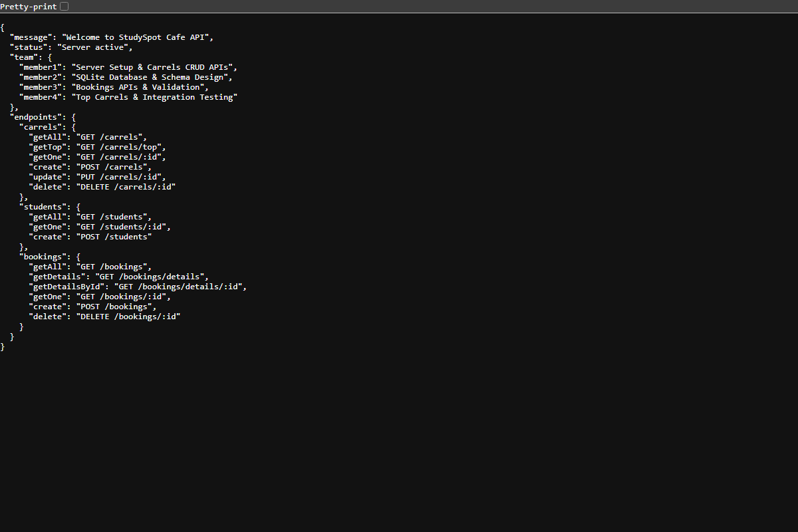

---

### 2. Carrels Endpoints & Operations

#### 2.1 GET `/carrels` – List All Study Carrels
* **Live URL:** [https://backend-group-assessment.onrender.com/carrels](https://backend-group-assessment.onrender.com/carrels)
* **HTTP Method:** `GET`
* **Status Code:** `200 OK`
* **Description:** Retrieves all study carrels seeded and stored in SQLite. Returns a JSON array containing `id`, `name`, and study `zone` for each carrel.

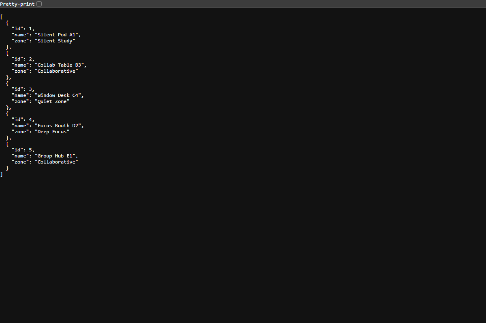

#### 2.2 GET `/carrels/top` – Top 3 Ranked Carrels (Member 4 Twist)
* **Live URL:** [https://backend-group-assessment.onrender.com/carrels/top](https://backend-group-assessment.onrender.com/carrels/top)
* **HTTP Method:** `GET`
* **Status Code:** `200 OK`
* **Description:** Member 4's special twist feature. Executes an SQL query using `INNER JOIN` with `bookings`, `GROUP BY`, `COUNT`, and `ORDER BY booking_count DESC, carrels.name ASC LIMIT 3`. Ranks the most utilized carrels by booking count, automatically resolving ties alphabetically.

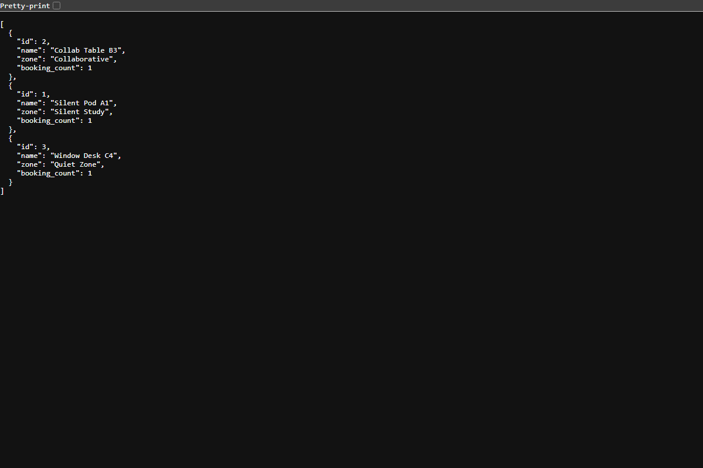

#### 2.3 GET `/carrels?zone=Silent Study` – Search / Filter by Zone
* **Live URL:** [https://backend-group-assessment.onrender.com/carrels?zone=Silent%20Study](https://backend-group-assessment.onrender.com/carrels?zone=Silent%20Study)
* **HTTP Method:** `GET`
* **Status Code:** `200 OK`
* **Description:** Filters carrels dynamically based on the requested zone query parameter (`?zone=Silent Study`), returning only carrels situated in the silent study area.

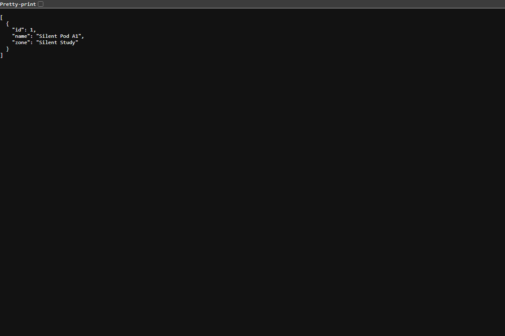

#### 2.4 GET `/carrels/1` – Retrieve Single Carrel by ID
* **Live URL:** [https://backend-group-assessment.onrender.com/carrels/1](https://backend-group-assessment.onrender.com/carrels/1)
* **HTTP Method:** `GET`
* **Status Code:** `200 OK`
* **Description:** Retrieves an individual carrel record using primary key parameter `:id`.

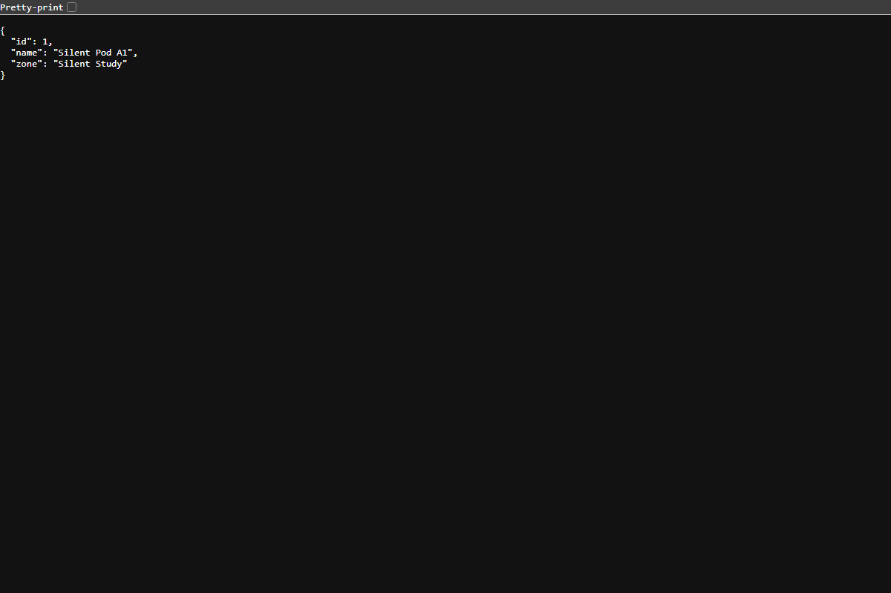

#### 2.5 POST `/carrels` – Create New Study Carrel
* **Live Endpoint:** `https://backend-group-assessment.onrender.com/carrels`
* **HTTP Method:** `POST`
* **Status Code:** `201 Created`
* **Request Payload:**
  ```json
  {
    "name": "Executive Pod X1",
    "zone": "Deep Focus"
  }
  ```
* **Description:** Inserts a new study carrel into the SQLite database with validation. Responds with HTTP 201 Created and the created record with auto-generated ID.

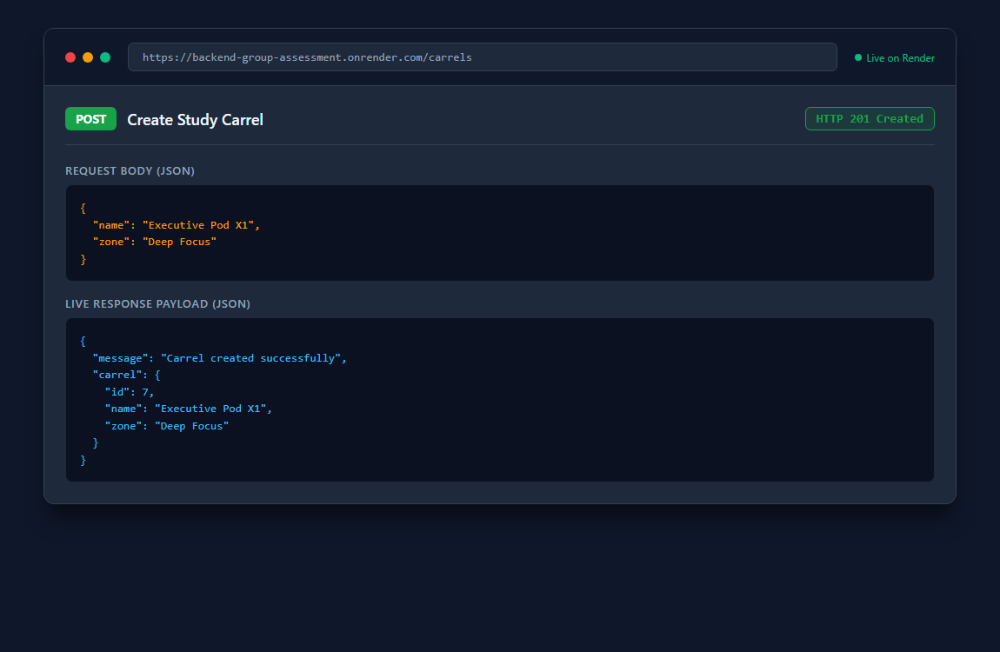

#### 2.6 PUT `/carrels/:id` – Update Study Carrel
* **Live Endpoint:** `https://backend-group-assessment.onrender.com/carrels/:id`
* **HTTP Method:** `PUT`
* **Status Code:** `200 OK`
* **Request Payload:**
  ```json
  {
    "name": "Executive Pod X1 (Upgraded Soundproof)",
    "zone": "Deep Focus"
  }
  ```
* **Description:** Updates the name and zone of an existing carrel identified by `:id`. Returns HTTP 200 OK and the modified object.

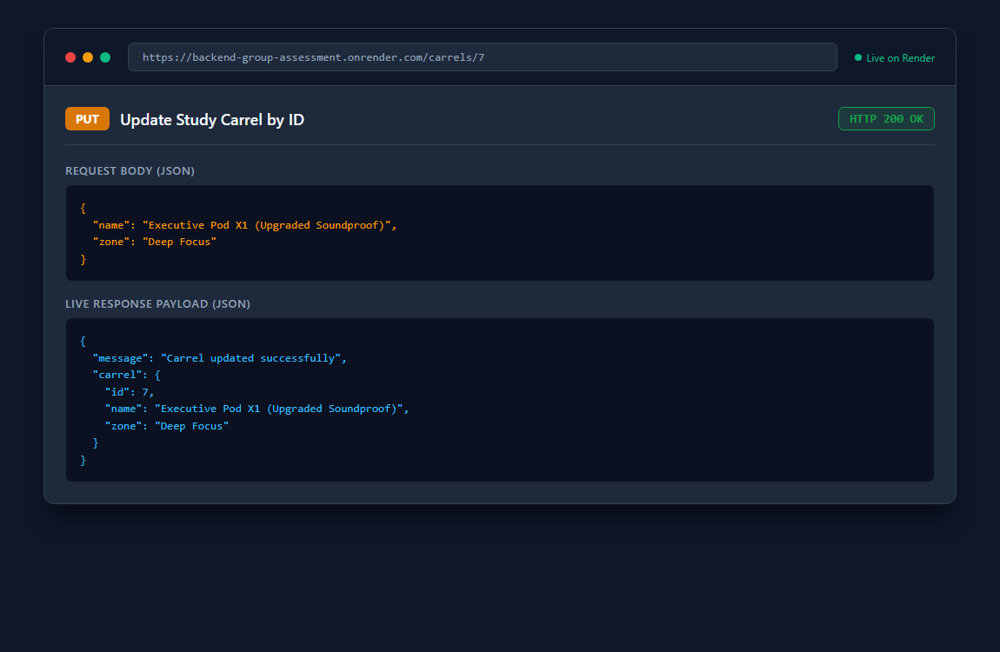

#### 2.7 DELETE `/carrels/:id` – Delete Study Carrel
* **Live Endpoint:** `https://backend-group-assessment.onrender.com/carrels/:id`
* **HTTP Method:** `DELETE`
* **Status Code:** `200 OK`
* **Description:** Deletes a carrel by its numeric primary key. Returns a confirmation message upon successful deletion.

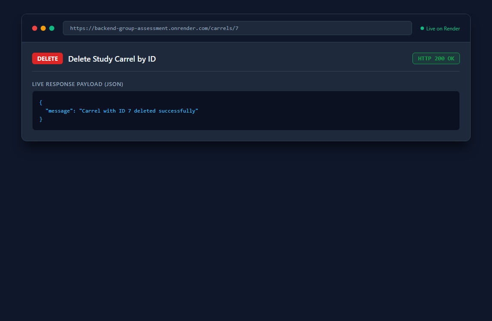

---

### 3. Students Endpoints & Operations

#### 3.1 GET `/students` – List All Students
* **Live URL:** [https://backend-group-assessment.onrender.com/students](https://backend-group-assessment.onrender.com/students)
* **HTTP Method:** `GET`
* **Status Code:** `200 OK`
* **Description:** Retrieves all students registered in the system, returning an array with student `id`, `name`, and unique `email`.

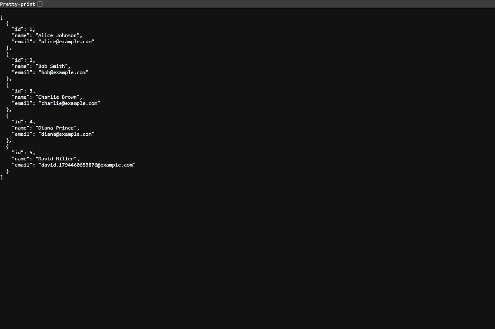

#### 3.2 GET `/students/1` – Retrieve Single Student by ID
* **Live URL:** [https://backend-group-assessment.onrender.com/students/1](https://backend-group-assessment.onrender.com/students/1)
* **HTTP Method:** `GET`
* **Status Code:** `200 OK`
* **Description:** Looks up a student by primary key ID and returns their details.


#### 3.3 POST `/students` – Register New Student
* **Live Endpoint:** `https://backend-group-assessment.onrender.com/students`
* **HTTP Method:** `POST`
* **Status Code:** `201 Created`
* **Request Payload:**
  ```json
  {
    "name": "Samantha Reed",
    "email": "student.live.1794460653876@example.com"
  }
  ```
* **Description:** Registers a new student. Enforces non-empty name validation and email uniqueness in SQLite.

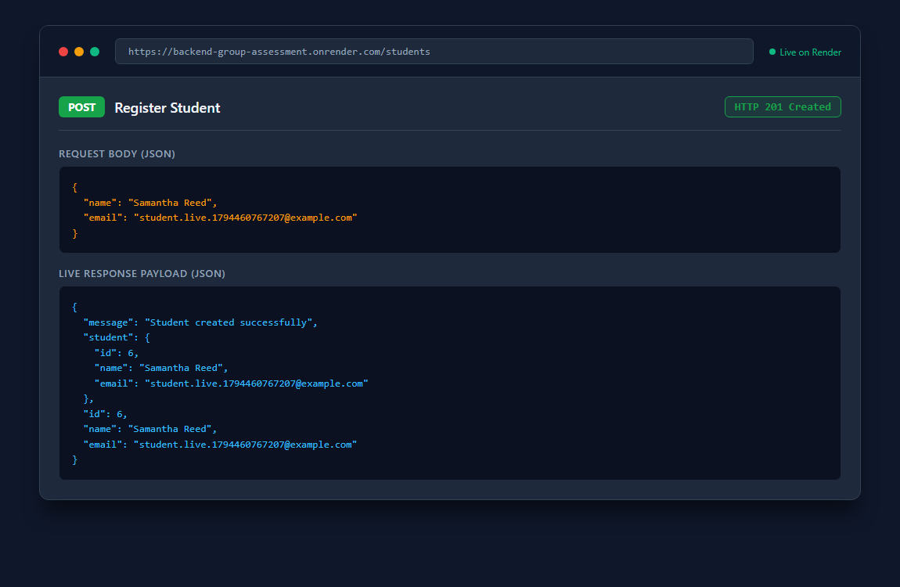

---

### 4. Bookings Endpoints & Relational Operations

#### 4.1 GET `/bookings` – List All Raw Bookings
* **Live URL:** [https://backend-group-assessment.onrender.com/bookings](https://backend-group-assessment.onrender.com/bookings)
* **HTTP Method:** `GET`
* **Status Code:** `200 OK`
* **Description:** Retrieves raw booking records containing foreign keys `student_id` and `carrel_id`, reservation date, and time slot.

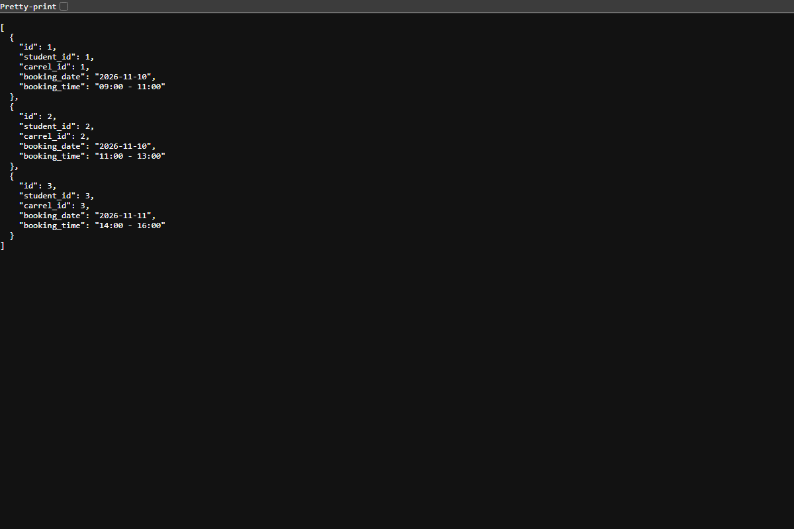

#### 4.2 GET `/bookings/details` – Bookings with Joined Information (SQL JOIN)
* **Live URL:** [https://backend-group-assessment.onrender.com/bookings/details](https://backend-group-assessment.onrender.com/bookings/details)
* **HTTP Method:** `GET`
* **Status Code:** `200 OK`
* **Description:** Executes a multi-table SQL JOIN combining `bookings`, `students`, and `carrels`. Returns enriched records with `student_name`, `student_email`, `carrel_name`, and `carrel_zone`.

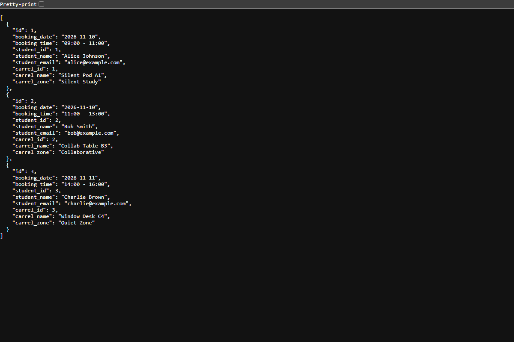

#### 4.3 GET `/bookings/details/1` – Single Booking Details with JOIN
* **Live URL:** [https://backend-group-assessment.onrender.com/bookings/details/1](https://backend-group-assessment.onrender.com/bookings/details/1)
* **HTTP Method:** `GET`
* **Status Code:** `200 OK`
* **Description:** Retrieves joined details for a specific booking ID, returning both student and carrel attributes in a single payload.

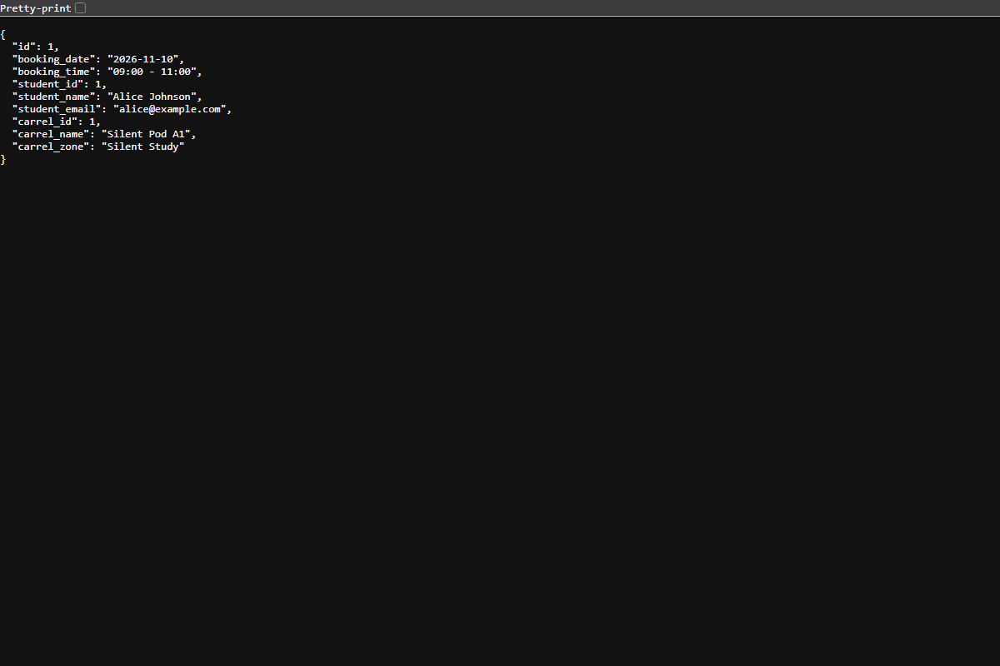

#### 4.4 GET `/bookings/1` – Retrieve Raw Booking by ID
* **Live URL:** [https://backend-group-assessment.onrender.com/bookings/1](https://backend-group-assessment.onrender.com/bookings/1)
* **HTTP Method:** `GET`
* **Status Code:** `200 OK`
* **Description:** Retrieves raw booking data by primary key ID.

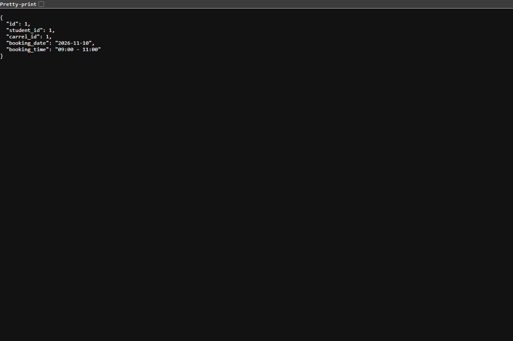

#### 4.5 POST `/bookings` – Create New Carrel Booking
* **Live Endpoint:** `https://backend-group-assessment.onrender.com/bookings`
* **HTTP Method:** `POST`
* **Status Code:** `201 Created`
* **Request Payload:**
  ```json
  {
    "student_id": 5,
    "carrel_id": 6,
    "booking_date": "2026-11-25",
    "booking_time": "10:00 - 12:00"
  }
  ```
* **Description:** Creates a new booking reservation. Enforces relational foreign key validation, ensuring both `student_id` and `carrel_id` exist prior to insertion.

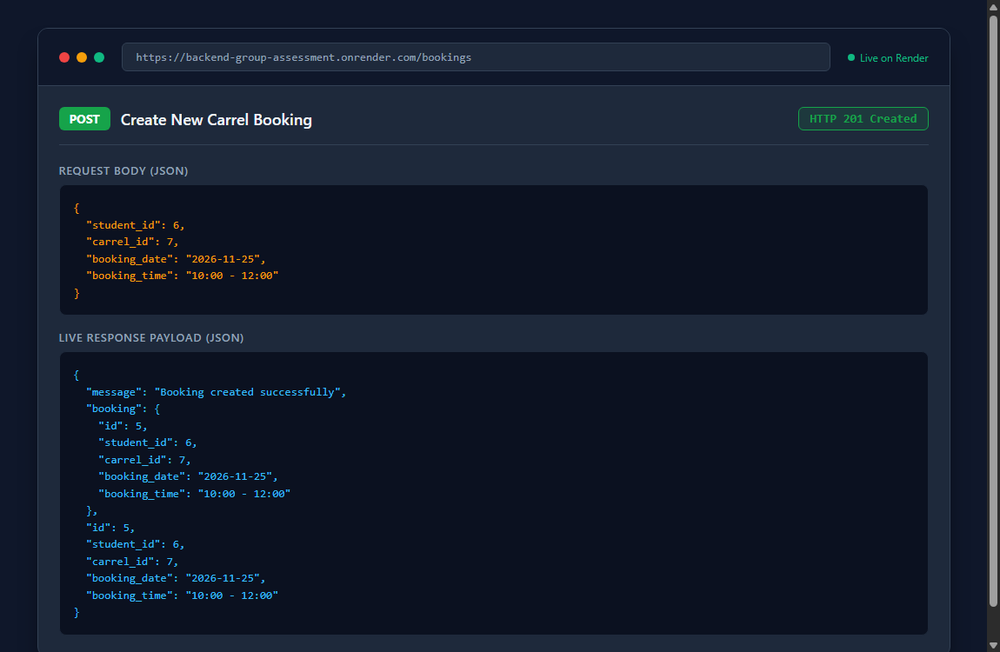

#### 4.6 DELETE `/bookings/:id` – Cancel / Delete Booking
* **Live Endpoint:** `https://backend-group-assessment.onrender.com/bookings/:id`
* **HTTP Method:** `DELETE`
* **Status Code:** `200 OK`
* **Description:** Deletes a booking record by ID, freeing up the carrel reservation.

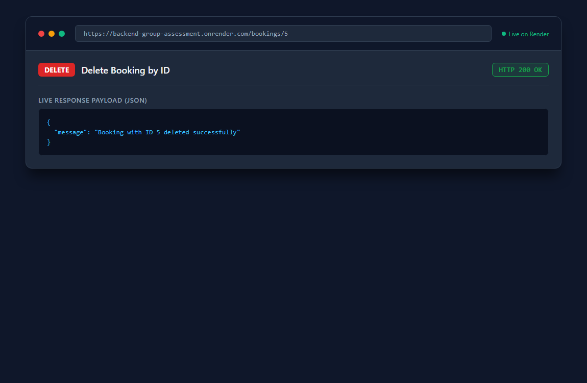

---

### 5. Input Validation & Error Handling Endpoints

#### 5.1 GET `/carrels/not-a-number` – 400 Bad Request (Invalid Parameter)
* **Live URL:** [https://backend-group-assessment.onrender.com/carrels/not-a-number](https://backend-group-assessment.onrender.com/carrels/not-a-number)
* **HTTP Method:** `GET`
* **Status Code:** `400 Bad Request`
* **Description:** Demonstrates robust input validation. Rejects non-integer ID parameters with HTTP 400 and a descriptive error message.

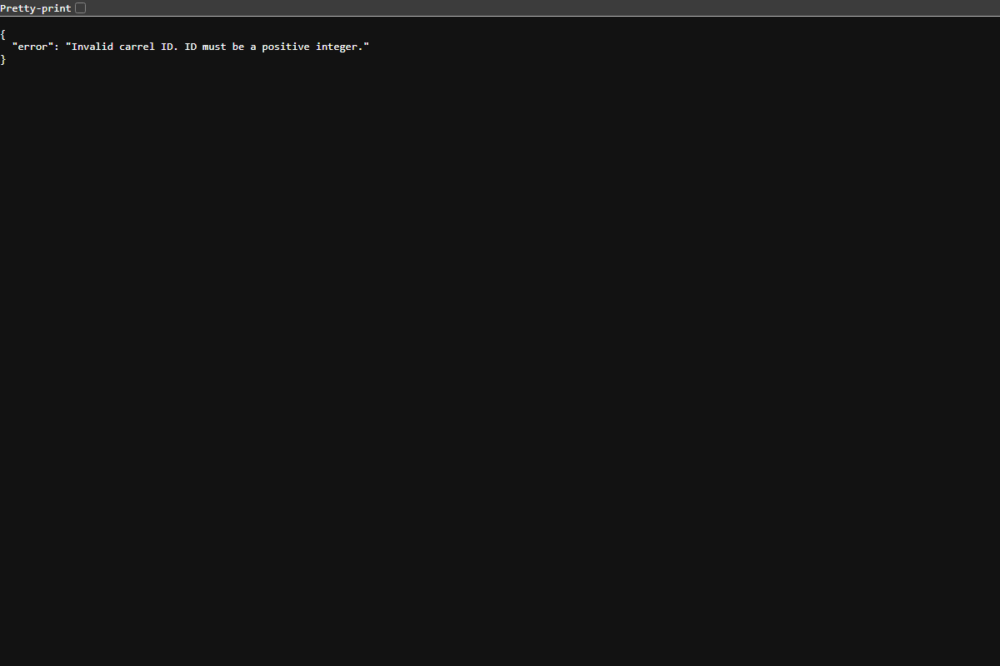

#### 5.2 GET `/unknown-route` – 404 Not Found Handling
* **Live URL:** [https://backend-group-assessment.onrender.com/unknown-route](https://backend-group-assessment.onrender.com/unknown-route)
* **HTTP Method:** `GET`
* **Status Code:** `404 Not Found`
* **Description:** Demonstrates global route catching. Any unrecognized endpoint responds with HTTP 404 and echoes the requested URL.

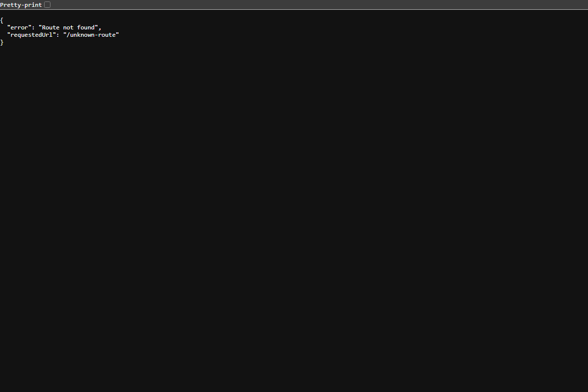
